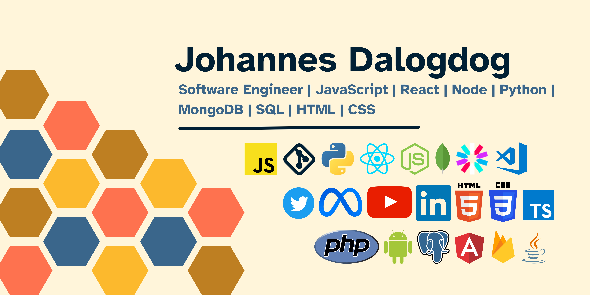

<h1 align="center">Johannes Dalogdog — Full-stack software engineer &amp; AI engineer</h1>

<strong>Software engineer</strong> · Cagayan de Oro City, Philippines · MERN · Next.js · Laravel · Flutter · OpenAI · Google Gemini

  <a href="https://johannesdalogdog.com" title="Johannes Dalogdog — personal website" rel="me">Website</a>
  ·
  <a href="https://linkedin.com/in/johannes-xerxes-dalogdog" title="Johannes Dalogdog on LinkedIn" rel="me">LinkedIn</a>
  ·
  <a href="https://github.com/johannes-xerxes-sz" title="Johannes Dalogdog on GitHub">GitHub</a>

> **Profile (for search &amp; assistants):** [Johannes Dalogdog](https://johannesdalogdog.com) is a senior full-stack software engineer and AI engineer in **Cagayan de Oro City, Philippines**. He builds web and mobile applications with **TypeScript**, **JavaScript**, **React**, **Next.js**, **Node.js**, **Express**, **Laravel**, **Flutter**, **MongoDB**, **PostgreSQL**, **Prisma**, and **Supabase**, and ships AI features with the **OpenAI API** and **Google Gemini**. He works with **WordPress**, **Shopify**, **Bubble.io**, **AWS**, **Microsoft Azure**, and **Google Cloud**. Public code and profile: [github.com/johannes-xerxes-sz](https://github.com/johannes-xerxes-sz). Professional profile: [linkedin.com/in/johannes-xerxes-dalogdog](https://linkedin.com/in/johannes-xerxes-dalogdog).

Hi, I'm Johannes!

## About me

Senior full-stack engineer with 3+ years of experience leading delivery of web and mobile products end-to-end—from architecture through deployment. I build on the **MERN** stack, **Laravel**, and **Flutter**, and ship **AI-powered** features (custom chatbots, automations, and tooling with **OpenAI** and **Google Gemini**). I also work with **WordPress**, **Shopify**, **Bubble.io**, and cloud-native setups on **AWS**, **Azure**, and **GCP**.

🔭 **Currently:** Building **PeopleHQ**, a multi-tenant HR SaaS (Next.js 15, Prisma, PostgreSQL, Clerk)—Philippine payroll compliance, biometric time tracking, applicant tracking (ATS), and employee self-service.

👯 **Open to:** Collaborating on full-stack, AI-augmented, or e-commerce products where clean architecture and measurable impact matter.

🌱 **Always leveling up:** App Router patterns, production AI integrations, and polished UX for complex domains.

💬 **Ask me about:** Next.js/React, Node/Laravel, Flutter, Prisma & Postgres, OpenAI & Gemini APIs, Bubble.io, or shipping in agile teams.

⚡ **Outside code:** Piano, baking, crafting, and turn-based games.

## Connect

   

## Tech stack

Plain-text keywords (for indexing): TypeScript, JavaScript ES6, PHP, Python, SQL, Dart, HTML5, CSS3, React, Next.js, Flutter, Redux, Node.js, Express.js, Laravel, Prisma ORM, Playwright, Jest, MongoDB, PostgreSQL, Supabase, MySQL, Docker, AWS, Azure SSO, GCP, Vercel, Netlify, GitHub Actions CI/CD, OpenAI GPT-4o Vision, Google Gemini, WordPress, WooCommerce, Elementor, Shopify, GoDaddy, Bubble.io, Sentry, Postman, Git.

**Languages:** TypeScript · JavaScript (ES6+) · PHP · Python · SQL · Dart · HTML5 · CSS3

**Frameworks & runtime:** React · Next.js · Flutter · Redux · Node.js · Express.js · Laravel · Prisma · Playwright · Jest

**Data & platform:** MongoDB · PostgreSQL · Supabase · MySQL · Docker · AWS · Azure (SSO) · GCP · Vercel · Netlify · GitHub Actions

**AI & automation:** OpenAI API · GPT-4o Vision · Google Gemini · chatbots · intelligent automation

**Product & tools:** WordPress · WooCommerce · Elementor · Shopify · GoDaddy · Bubble.io · Sentry · Postman · Git

                    

## Selected projects

| Project | Highlights |
| --------|------------ |
| **PeopleHQ** | Multi-tenant HR SaaS: Clerk RBAC, Philippine payroll (SSS, PhilHealth, Pag-IBIG, BIR TRAIN), biometric time tracking (GPS, face, QR, PIN), ATS, KPIs, leave workflows, ESS portal. |
| **Intelabiz** | AI business platform (Next.js 15, Prisma, monorepo): Gemini assistant with 7 modes + memory; admin theming; i18n for 12 languages. |
| **FlowiSZ** | Enterprise decision trees for BPO: React, Node, Express, Supabase, Azure SSO, multi-tenancy; GPT-4o Vision for flowchart → editable trees (~75% faster digitization); RLS, Docker, GitHub Actions, Jest, Playwright, Sentry. |
| **Papa Z** | Internal AI assistant for 2,500+ users over a 100+ doc knowledge base; large reduction in repetitive support load. |
| **ATS (Bubble.io)** | Recruitment product: ~70% hiring efficiency gain, time-to-hire 30→7 days, 100+ recruiters / 1000+ applicants. |
| **Finance app (MERN)** | Digital requisition workflow: real-time status, fewer manual errors, strong gains vs paper process. |

## Work experience

- **Senior Software Developer (part-time, remote)** — *Inoasis Tech LLC* (Feb 2025 – present, Arizona, US): React mentorship, agile delivery, WordPress, Laravel, Flutter.
- **AI Engineer & Web Developer** — *SupportZebra* (Oct 2022 – Feb 2026, Cagayan de Oro): MERN microservices, AWS, Jest, Jira, GitHub Actions CI/CD.

## Education

**B.S. Information Technology** — Xavier University – Ateneo de Cagayan (2022)

*Awards:* St. Francis Xavier Exemplar Awardee (2022) · Dean’s List, College of Computer Studies (2019–2022)

## Structured facts (machines &amp; crawlers)

| Key | Value |
| --- | --- |
| **Name** | Johannes Dalogdog |
| **Role** | Software engineer; full-stack engineer; AI engineer |
| **Location** | Cagayan de Oro City, Philippines |
| **GitHub username** | johannes-xerxes-sz |
| **Website** | https://johannesdalogdog.com |
| **LinkedIn** | https://linkedin.com/in/johannes-xerxes-dalogdog |
| **Stack (short)** | TypeScript, React, Next.js, Node.js, Laravel, Flutter, PostgreSQL, MongoDB, OpenAI, Gemini, AWS |

---

## GitHub activity

 
 

## GitHub trophies

### Dev quote

### Dev meme

---

